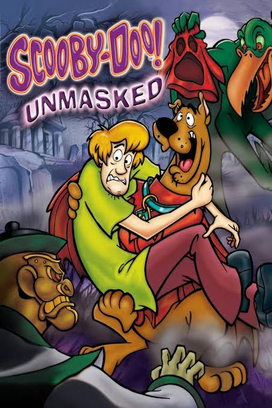

# Tradução PT-BR — Scooby-Doo! Unmasked (PS2)

Patch de tradução para Português Brasileiro do jogo **Scooby-Doo! Unmasked** (PlayStation 2), feito por fã para fãs.

---

## O que vem no download

- `Scooby-Doo Unmasked (PT-BR).xdelta` — o patch de tradução (formato xdelta)
- `LEIA-ME.txt` — instruções completas de instalação (em português)

## Requisitos

- ISO original e limpa do jogo **Scooby-Doo! Unmasked** Americana (SLUS-21091) de PS2. Sem outras modificações
- [Delta Patcher](https://github.com/marco-calautti/DeltaPatcher) — ferramenta gratuita para aplicar o patch

## Como instalar

1. Baixe o [Delta Patcher](https://github.com/marco-calautti/DeltaPatcher/releases) para o seu sistema operacional
2. Baixe o arquivo `Scooby-Doo Unmasked (PT-BR).xdelta` deste repositório (aba **Releases** — vem dentro do arquivo .zip)
3. Abra o Delta Patcher, selecione o modo Apply Patch
4. Selecione o `Scooby-Doo Unmasked (PT-BR).xdelta`, sua ISO original e o nome do arquivo de destino
5. Clique em Apply e aguarde a conclusão

Instruções detalhadas passo a passo estão no arquivo `LEIA-ME.txt`.

## Capturas de tela

   
   
   
  

## Aviso legal

Este repositório não distribui nenhum arquivo do jogo original. O patch apenas modifica bytes de uma ISO que o usuário já possui legalmente. Nenhum conteúdo protegido por direitos autorais da THQ/Warner Bros./Hanna-Barbera está incluído aqui.

## Créditos

- Tradução e romhack: [refresh]
- Ferramenta de patch: [Delta Patcher](https://github.com/marco-calautti/DeltaPatcher) por marco-calautti

## 💬 Dúvidas ou problemas?

Abra uma [Issue](../../issues) neste repositório contando o problema e a versão do seu jogo.
